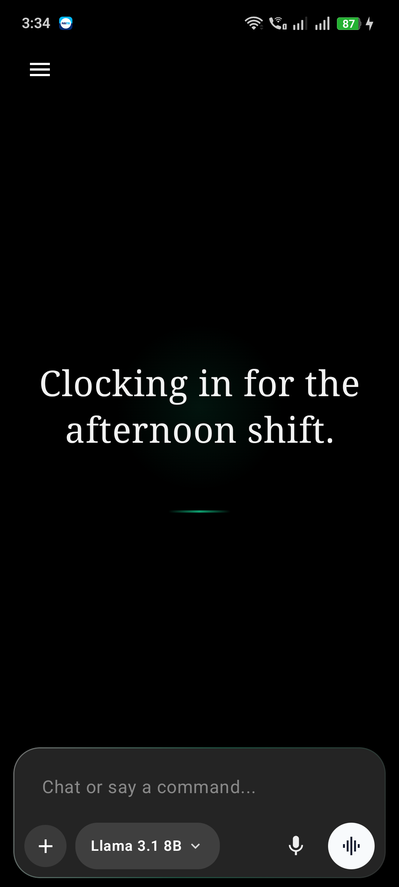

# AUREX AI

An advanced Android mobile assistant featuring an interactive voice orb, glassmorphism UI,
theme support, device automation, screen vision, and intelligent AI chat.

<p align="center">
  
</p>

## Highlights

- **Interactive voice orb** — real-time listening and speech feedback with local TTS
  (Piper / onnxruntime) so responses play on-device.
- **AgentRing calling bridge** — inbound/outbound call handling over a relay API plus a
  persistent WebSocket, with pairing flow (`PairActivity`) and URL policy enforcement.
- **Device automation** — app launch, Wi-Fi/hotspot control, ADB-driven UI inspection
  (`device_automation/`), and a bundled `mobile-use` agent toolkit.
- **Screen vision** — on-device screen understanding that routes frames to a vision model
  and falls back gracefully when no key is configured.
- **Multi-provider LLM support** — Gemini and NVIDIA NIM, switchable at runtime, with
  streaming responses, personality presets, and prompt customization.
- **Local-first memory** — SQLite-backed unified memories, notes, preferences, and chat
  history (`unified_memories`, `jarvis_notes`, `app_preferences`, `chat_messages`).

## Requirements

- Android Studio with **AGP 9.1.1** / **Kotlin 2.1.0**
- **JDK 17+**
- **compileSdk 35**, **minSdk 26**, **targetSdk 35**
- A physical device or emulator running **Android 8.0 (API 26)** or newer

## Setup

1. Clone the repository:

   ```bash
   git clone https://github.com/mahammed123-lab/AUREX.git
   cd AUREX
   ```

2. Create a `.env` file in the project root:

   ```bash
   cp .env.example .env
   ```

   ```dotenv
   GEMINI_API_KEY=your_key_here
   NVIDIA_API_KEY=your_key_here
   ```

   Keys are read from the environment (or `.env`) at build time and injected via
   `BuildConfig`. No key literal lives in source — `.env` is gitignored.

3. Build and run:

   ```bash
   ./gradlew assembleDebug
   ```

   Or open the project in Android Studio and run the `app` configuration.

4. The app also accepts a key at runtime via **Settings → API Key**, which is stored in
   the local preferences database and takes priority over the build-time default.

> **Note:** `app/build.gradle.kts` references a local `debug.keystore` for signing. Replace
> it with your own keystore before producing any release build.

## Project layout

```
app/                      Main Android application (Kotlin + Jetpack Compose)
  src/main/java/com/example/
    agentring/            AgentRing relay + WebSocket bridge
    call/                 Call service, activity, pairing, bridge API
    data/                 Repositories, preferences, personality models
    persona/              Persona and prompt definitions
    spotify/              Spotify auth integration
    telephony/            Telephony and call-state handling
    ui/                   ViewModel, overlay, and screen UI
    vision/               Screen capture and vision pipeline
    voice/                Voice input and TTS integration
    websearch/            Web search provider integration
browser_service/          Headless browser automation service
device_automation/        ADB toolkit and the `mobile-use` agent framework
future-agi/               Experiment configuration
piper-tts-android/        On-device TTS runtime and native libraries
```

## Third-party components

`device_automation/` vendors two upstream projects, each retaining its own license:

- `mobile-use` — Apache License 2.0 (`device_automation/mobile-use/mobile-use-main/LICENSE`)
- `adb-kit` — see `device_automation/adb-kit/android-adb-automation-kit-main/LICENSE`

## Security

API keys and credentials are never committed. `.env`, `*.keystore`, and
`google-services.json` are excluded via `.gitignore`. If you contribute, keep secrets in
`.env` only.

## License

Source code in this repository is provided as-is. Vendored third-party components retain
their original licenses as noted above.
